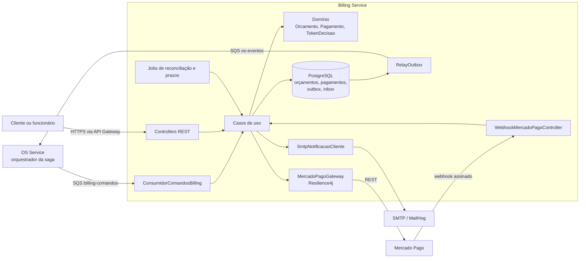
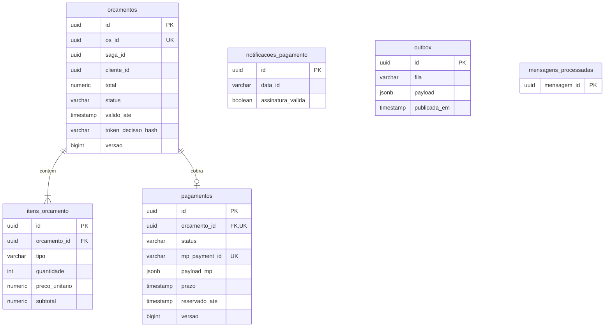
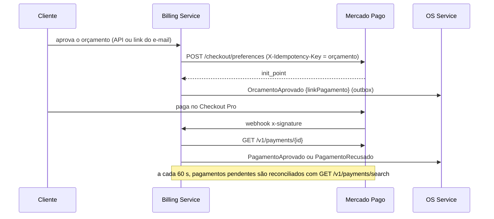

# oficina-billing-service

Serviço de orçamento e pagamento do sistema de gestão de oficina mecânica, desenvolvido no Tech Challenge da PosTech FIAP (Arquitetura de Software, Fase 4). Gera o orçamento a partir dos itens enviados pelo serviço de ordens de serviço, envia o orçamento ao cliente, registra a aprovação ou a reprovação, cobra pelo Mercado Pago (Checkout Pro), estorna pagamentos nas compensações e comunica cada resultado ao orquestrador da saga por mensagens assíncronas.

[](https://sonarcloud.io/summary/new_code?id=Guilherme-Fumagali_oficina-billing-service)
[](https://sonarcloud.io/summary/new_code?id=Guilherme-Fumagali_oficina-billing-service)
[](https://sonarcloud.io/summary/new_code?id=Guilherme-Fumagali_oficina-billing-service)

## Repositórios do projeto

| Repositório | Conteúdo |
|---|---|
| [tech-challenge-1](https://github.com/Guilherme-Fumagali/tech-challenge-1) | OS Service: clientes, veículos, catálogo, estoque, ordens de serviço e orquestrador da saga |
| [oficina-billing-service](https://github.com/Guilherme-Fumagali/oficina-billing-service) | Billing Service: orçamento e pagamento (este repositório) |
| [oficina-execution-service](https://github.com/Guilherme-Fumagali/oficina-execution-service) | Execution Service: fila de execução, diagnóstico e reparo |
| [oficina-auth-lambda](https://github.com/Guilherme-Fumagali/oficina-auth-lambda) | Autenticação por CPF com segundo fator |
| [oficina-infra-k8s](https://github.com/Guilherme-Fumagali/oficina-infra-k8s) | Plataforma: rede, EKS, API Gateway, ECR e New Relic |

## Links

| Artefato | Local |
|---|---|
| Contrato OpenAPI | [`docs/openapi.json`](docs/openapi.json), visualizável no [Redoc](https://redocly.github.io/redoc/?url=https://raw.githubusercontent.com/Guilherme-Fumagali/oficina-billing-service/develop/docs/openapi.json) |
| Contrato de mensagens (AsyncAPI 2.6) | [`docs/asyncapi.yaml`](docs/asyncapi.yaml) |
| Coleção Postman | [`docs/postman/billing.postman_collection.json`](docs/postman/billing.postman_collection.json) |
| Preparação da conta do Mercado Pago | [`docs/mercado-pago.md`](docs/mercado-pago.md) |
| Swagger UI | `http://localhost:8081/swagger-ui.html` na execução local |
| Documentação de arquitetura da fase (ADRs, SPECs, diagramas) | [`tech-challenge-1/docs/tech-challenge-4`](https://github.com/Guilherme-Fumagali/tech-challenge-1/tree/develop/docs/tech-challenge-4) |
| Vídeo de demonstração | a publicar |

## Arquitetura

O serviço roda no EKS, atrás do API Gateway, com Deployment, Service NodePort `30081` e listener `8081` no Network Load Balancer. Persiste no próprio RDS PostgreSQL, consome a fila `billing-comandos`, publica na fila `os-eventos` e chama a API do Mercado Pago pela internet (NAT). Telemetria vai para o New Relic.



O código segue Clean Architecture, com as mesmas convenções do OS Service:

```
src/main/java/com/oficina/billing/
├── domain/          Orcamento, ItemOrcamento, Pagamento, TokenDecisao, exceções e portas de repositório
├── application/     casos de uso, portas (gateway de pagamento, notificação, mensagens, unidade de trabalho,
│                    relógio, métricas), comandos recebidos e eventos publicados
└── infrastructure/  Spring Boot: JPA e Flyway, outbox, inbox e SQS, Mercado Pago, SMTP, REST, segurança JWT,
                     agendamentos e métricas
```

Os casos de uso são classes Java sem anotações de framework, instanciadas em `UseCaseConfig`. Todo caso de uso que escreve usa a porta `UnidadeDeTrabalho`, implementada com `TransactionTemplate`, e grava a mensagem de saída no outbox na mesma transação da mudança de estado.

## Papel na saga

A saga da ordem de serviço é orquestrada pelo OS Service (ADR-017). O Billing Service é participante: recebe comandos, executa a transação local e responde com eventos. As respostas carregam o `sagaId` do comando e, quando há comando de origem, o `mensagemId` dele em `causadaPor`.

| Passo da saga | Billing recebe ou detecta | Billing faz | Billing publica |
|---|---|---|---|
| Diagnóstico concluído com itens | `GerarOrcamento` | cria o orçamento com token de decisão e envia o e-mail com itens, total, validade e links | `OrcamentoGerado` ou `ComandoRejeitado` |
| Decisão do cliente | aprovação ou reprovação (API ou link do e-mail) | na aprovação, cria a cobrança no Mercado Pago e o pagamento `PENDENTE` | `OrcamentoAprovado` com o link de pagamento, ou `OrcamentoReprovado` |
| Validade do orçamento | job de prazos (5 min) | marca `EXPIRADO` | `OrcamentoExpirado` |
| Pagamento | webhook ou reconciliação (60 s) | consulta o pagamento no Mercado Pago e aplica o status | `PagamentoAprovado` ou `PagamentoRecusado` |
| Prazo do pagamento | job de prazos (5 min) | reconcilia uma última vez e marca `EXPIRADO` | `PagamentoRecusado` com motivo `EXPIRADO` |
| Compensação de pagamento recusado ou de falha na execução | `CancelarOrcamento` | cancela o orçamento, se existir (idempotente) | `OrcamentoCancelado` (`orcamentoId` nulo se a OS não tem orçamento) |
| Compensação de falha na execução | `EstornarPagamento` | estorna no Mercado Pago o pagamento aprovado | `PagamentoEstornado` (valor zero se não havia pagamento aprovado) |

Comandos repetidos com `mensagemId` novo (reenvio por prazo no orquestrador) produzem a mesma resposta de negócio: `GerarOrcamento` para uma OS que já tem orçamento publica `OrcamentoGerado` com os dados existentes, `CancelarOrcamento` sobre orçamento cancelado responde `OrcamentoCancelado` e `EstornarPagamento` sobre pagamento estornado repete `PagamentoEstornado`.

As compensações são idempotentes e sempre respondidas com sucesso (SPEC-08 §5.3): `CancelarOrcamento` para uma OS sem orçamento responde `OrcamentoCancelado` com `orcamentoId` nulo e o `motivo` recebido, e `EstornarPagamento` sem pagamento aprovado responde `PagamentoEstornado` com valor zero. `ComandoRejeitado` fica restrito a comandos com dados malformados (`DADOS_INVALIDOS`).

## Mensagens

Contrato completo, com esquemas e exemplos: [`docs/asyncapi.yaml`](docs/asyncapi.yaml), derivado da SPEC-08. Todas as mensagens usam o envelope `mensagemId`, `tipo`, `versao`, `sagaId`, `osId`, `causadaPor`, `origem`, `ocorridoEm`, `dados`; valores monetários têm duas casas decimais e datas são ISO-8601 em UTC.

**Consumidas** em `oficina-<ambiente>-billing-comandos`:

| Tipo | Dados | Resposta |
|---|---|---|
| `GerarOrcamento` | `clienteId`, `cliente{nome, email}`, `veiculo{placa, modelo}`, `itens[{tipo, referenciaId, descricao, quantidade, precoUnitario}]` | `OrcamentoGerado` ou `ComandoRejeitado` (`DADOS_INVALIDOS`) |
| `CancelarOrcamento` | `motivo` | `OrcamentoCancelado` (`orcamentoId` nulo se a OS não tem orçamento) |
| `EstornarPagamento` | `motivo` | `PagamentoEstornado` (valor zero se não há pagamento aprovado) |

**Publicadas** em `oficina-<ambiente>-os-eventos`: `OrcamentoGerado`, `OrcamentoAprovado`, `OrcamentoReprovado`, `OrcamentoExpirado`, `OrcamentoCancelado`, `PagamentoAprovado`, `PagamentoRecusado`, `PagamentoEstornado` e `ComandoRejeitado`.

Garantias de entrega:

| Mecanismo | Implementação |
|---|---|
| Transactional outbox | a mensagem é gravada na tabela `outbox` na mesma transação da mudança de estado; nenhum caso de uso chama a SQS |
| Relay | `RelayOutbox` (a cada 500 ms) reivindica até 50 linhas com `SELECT … FOR UPDATE SKIP LOCKED`, envia com `SqsTemplate` e marca `publicada_em`; em falha incrementa `tentativas` e guarda `ultimo_erro` |
| Consumidor idempotente | `INSERT … ON CONFLICT DO NOTHING` em `mensagens_processadas` no início da transação do efeito; duplicata exata é descartada sem erro |
| Dados malformados | resposta `ComandoRejeitado` com código `DADOS_INVALIDOS` e reconhecimento da mensagem, sem nova tentativa |
| Falha técnica | exceção, a mensagem volta após a visibilidade de 30 s e vai para a DLQ após 5 recebimentos |
| Tolerância a campos novos | `FAIL_ON_UNKNOWN_PROPERTIES` desligado no consumo |

Atributos SQS de cada mensagem: `tipo`, `versao` e os cabeçalhos de rastreamento `newrelic`, `traceparent` e `tracestate`.

## Banco e justificativa

PostgreSQL 16 em instância RDS própria (`oficina-billing-db-<ambiente>`, banco `billing`), com schema criado pelo Flyway (`V1__schema_inicial.sql`) e `ddl-auto: validate`.



| Critério | Como o PostgreSQL atende |
|---|---|
| Unicidade de dinheiro | um orçamento por OS (`os_id UNIQUE`), um pagamento por orçamento (`orcamento_id UNIQUE`) e cada pagamento do Mercado Pago aplicado uma vez (`mp_payment_id UNIQUE`) |
| Invariantes no banco | `CHECK` de status, de quantidade maior que zero e de preço e total positivos |
| Concorrência | `@Version` em `orcamentos` e `pagamentos` (lock otimista com releitura dentro da transação) e `FOR UPDATE SKIP LOCKED` nos jobs e no relay, o que permite várias réplicas |
| Atomicidade | mudança de estado, outbox e inbox na mesma transação local |
| Auditoria e conciliação | `payload_mp` em `jsonb` com a última resposta do Mercado Pago, tabela `notificacoes_pagamento` com cada webhook recebido e consultas SQL para relatórios de faturamento |

Alternativas descartadas:

- **MongoDB** (o exemplo `bills` da aula de Data Engineering atende o formato): troca as constraints relacionais por disciplina de aplicação justamente no serviço que lida com dinheiro, onde unicidade e consistência são o requisito principal.
- **Mesma instância do OS Service**: violaria o banco por serviço; uma falha, uma carga alta ou uma credencial vazada em um serviço atingiria o outro. Cada serviço recebe apenas as próprias credenciais, em `/oficina/<ambiente>/billing/*` no SSM.

## Integração com o Mercado Pago

Checkout Pro com webhook assinado e reconciliação por consulta ([ADR-021](https://github.com/Guilherme-Fumagali/tech-challenge-1/blob/develop/docs/tech-challenge-4/adrs/ADR-021-mercado-pago-checkout-pro.md)). O roteiro de preparação da conta, das credenciais e dos secrets está em [`docs/mercado-pago.md`](docs/mercado-pago.md).



| Aspecto | Implementação |
|---|---|
| Cliente HTTP | `RestClient` sem SDK, `Authorization: Bearer ${MP_ACCESS_TOKEN}`, timeouts de 2 s (conexão) e 5 s (leitura) |
| Resiliência | Resilience4j `Retry` (3 tentativas, backoff exponencial, apenas erro de rede e 5xx) e `CircuitBreaker` (janela de 10 chamadas, 50% de falhas, 30 s aberto); erro 4xx não é repetido |
| Idempotência | `X-Idempotency-Key` com o id do orçamento na criação da preferência e com o id do pagamento no estorno |
| Preferência | um item por item do orçamento em BRL, `external_reference` = id do orçamento, `notification_url` por preferência, `binary_mode: true`, `expires: true` e `expiration_date_to` = prazo do pagamento (24 h) |
| Webhook | `POST /api/pagamentos/webhooks/mercado-pago`, público no API Gateway; manifesto `id:{data.id};request-id:{x-request-id};ts:{ts};` com `data.id` alfanumérico em minúsculas, HMAC-SHA256 com `MP_WEBHOOK_SECRET` e comparação em tempo constante; assinatura ausente ou inválida responde 401 |
| Fonte do status | sempre a consulta autenticada `GET /v1/payments/{id}`, nunca o corpo da notificação |
| Registro | cada notificação recebida grava `notificacoes_pagamento` (request id, data id, tipo, assinatura válida, horário) |
| Reconciliação | job a cada 60 s para pagamentos pendentes criados há mais de 60 s; as linhas são reservadas por 2 minutos (`reservado_ate`) com `FOR UPDATE SKIP LOCKED`, e as chamadas HTTP acontecem fora da transação |
| Recusa | com `PAGAMENTO_RECUSA_ENCERRA=true` (padrão), a primeira recusa encerra o pagamento e publica `PagamentoRecusado` com o `status_detail` |
| Pagamento tardio | pagamento aprovado que chega para orçamento cancelado ou pagamento já encerrado é estornado automaticamente e o pagamento passa a `ESTORNADO` |
| Mapeamento de status | `approved` → `APROVADO`; `rejected`, `cancelled` → `RECUSADO`; `refunded`, `charged_back` → `ESTORNADO`; `pending`, `in_process`, `authorized` → `PENDENTE` |

Cartões de teste (titular define o resultado): nome `APRO` aprova o pagamento e `OTHE` recusa. Números, CPF de teste e demais nomes estão em [`docs/mercado-pago.md`](docs/mercado-pago.md#8-testes-de-pagamento).

No perfil `local`, o `GatewayPagamentoSimulado` substitui o Mercado Pago: o link de pagamento aponta para `GET /api/pagamentos/simulacao/{orcamentoId}`, que oferece as opções aprovado e recusado e percorre o mesmo caso de uso do webhook. Esse endpoint só existe no perfil `local` e não aparece no `docs/openapi.json`.

## Tecnologias

| Área | Tecnologia |
|---|---|
| Linguagem e framework | Java 21, Spring Boot 3.4.7 |
| Persistência | PostgreSQL 16, Spring Data JPA, Flyway |
| Mensageria | Amazon SQS, Spring Cloud AWS 3.3.1 (`SqsTemplate`, `@SqsListener`) |
| Pagamento | Mercado Pago Checkout Pro via `RestClient`, Resilience4j 2.2.0 |
| Segurança | Spring Security, JJWT 0.12.6 (validação de JWT HS256) |
| Documentação da API | SpringDoc OpenAPI 2.7.0, AsyncAPI 2.6 |
| Observabilidade | agente Java do New Relic 9.4.0 e `newrelic-api`, Micrometer com OTLP, logs ECS |
| Testes | JUnit 5, Mockito, AssertJ, WireMock 3.9.2, Testcontainers 1.20.3 (PostgreSQL e LocalStack), Awaitility, JaCoCo |
| Build e implantação | Maven, Docker, Kustomize, Terraform, GitHub Actions, Amazon ECR, Amazon EKS |

## Execução local

Pré-requisitos: Docker e Docker Compose, com as portas `8081`, `5433`, `4566`, `1025` e `8025` livres.

```bash
cp .env.example .env
docker compose up --build
```

| Serviço | Endereço |
|---|---|
| API | `http://localhost:8081` |
| Swagger UI | `http://localhost:8081/swagger-ui.html` |
| MailHog (e-mails de orçamento e de pagamento) | `http://localhost:8025` |
| LocalStack (SQS) | `http://localhost:4566` |

O LocalStack cria na subida as filas `oficina-local-os-eventos`, `oficina-local-billing-comandos` e `oficina-local-execution-comandos`, cada uma com a DLQ `-dlq` e `maxReceiveCount` 5 ([`localstack/init/ready.d/criar-filas.sh`](localstack/init/ready.d/criar-filas.sh)). O compose usa o perfil `local`: credenciais AWS estáticas `test/test`, simulador de pagamento e assinatura do webhook opcional.

Para gerar um orçamento sem o OS Service, publique um comando na fila de comandos:

```bash
docker compose exec localstack awslocal sqs send-message \
  --queue-url http://localhost:4566/000000000000/oficina-local-billing-comandos \
  --message-attributes 'tipo={DataType=String,StringValue=GerarOrcamento},versao={DataType=String,StringValue=1}' \
  --message-body '{"mensagemId":"'"$(uuidgen)"'","tipo":"GerarOrcamento","versao":1,"sagaId":"'"$(uuidgen)"'","osId":"'"$(uuidgen)"'","origem":"os-service","ocorridoEm":"2026-10-30T14:05:11Z","dados":{"clienteId":"'"$(uuidgen)"'","cliente":{"nome":"Maria Souza","email":"maria@example.com"},"veiculo":{"placa":"ABC1D23","modelo":"Corolla"},"itens":[{"tipo":"SERVICO","referenciaId":"'"$(uuidgen)"'","descricao":"Troca de óleo","quantidade":1,"precoUnitario":120.00}]}}'
```

O e-mail com os links de decisão aparece no MailHog; o evento `OrcamentoGerado` fica na fila `oficina-local-os-eventos`. As rotas autenticadas aceitam um JWT HS256 assinado com a `JWT_SECRET` do `.env`, emissor `oficina-auth`, `sub` em formato UUID e `role` `CLIENTE` ou `FUNCIONARIO`, como fazem os testes de integração.

Sem Docker para a aplicação (banco e LocalStack do compose):

```bash
docker compose up -d db localstack mailhog
./mvnw spring-boot:run -Dspring-boot.run.profiles=local
```

### Variáveis de ambiente

| Variável | Padrão | Descrição |
|---|---|---|
| `DB_URL` / `DB_USER` / `DB_PASS` | `jdbc:postgresql://localhost:5433/billing` / `billing` / `billing` | Banco do serviço |
| `JWT_SECRET` | sem padrão fora dos perfis `local` e `test` | Chave HMAC dos tokens emitidos pela Lambda de autenticação |
| `APP_URL_PUBLICA` | `http://localhost:8081` | URL do API Gateway; base dos links do e-mail e da `notification_url` |
| `MP_ACCESS_TOKEN` | — | Access token do vendedor de teste do Mercado Pago |
| `MP_WEBHOOK_SECRET` | — | Assinatura secreta do webhook |
| `MP_EXIGIR_ASSINATURA` | `true` (`false` no perfil `local`) | Recusa webhooks sem assinatura válida |
| `MP_USAR_SANDBOX_INIT_POINT` | `false` | Usa o `sandbox_init_point` no link de pagamento |
| `MP_EMAIL_PAGADOR_TESTE` | — | E-mail do comprador de teste enviado em `payer.email`; em homologação vem da variável do GitHub de mesmo nome, em produção fica vazio |
| `ORCAMENTO_VALIDADE_HORAS` | `168` | Validade do orçamento e do link de decisão |
| `PAGAMENTO_PRAZO_HORAS` | `24` | Prazo do pagamento |
| `PAGAMENTO_RECUSA_ENCERRA` | `true` | A primeira recusa encerra o pagamento |
| `NOTIFICACAO_CANAL` | `log` | `smtp` envia e-mail; `log` apenas registra, sem o token |
| `SMTP_HOST` / `SMTP_PORT` / `MAIL_FROM` | `localhost` / `1025` / `oficina@example.com` | Servidor de e-mail |
| `FILA_OS_EVENTOS` / `FILA_BILLING_COMANDOS` / `FILA_DLQ` | `oficina-local-…` | Nomes das filas |
| `AWS_REGION` / `SQS_ENDPOINT` | `us-east-1` / `http://localhost:4566` (perfil `local`) | SQS; no cluster as credenciais vêm da Pod Identity |
| `ENV` | `local` | Atributo `env` das métricas |
| `SPRING_PROFILES_ACTIVE` | — | `local` (compose), `k8s` (log ECS em JSON) |
| `NEW_RELIC_LICENSE_KEY` / `NEW_RELIC_APP_NAME` | — | Ativam o agente e a exportação OTLP |
| `GIT_COMMIT` | `local` | Commit exibido em `/actuator/info`, definido no build da imagem |

## Implantação

| Branch | Ambiente | Aprovação |
|---|---|---|
| `develop` | homologação (`staging`) | não |
| `main` | produção (`prod`) | sim, no GitHub Environment `prod` |

A infraestrutura do serviço fica em [`infra/`](infra) (Terraform, state `billing/<ambiente>/terraform.tfstate`):

| Recurso | Detalhe |
|---|---|
| RDS PostgreSQL 16 | `oficina-billing-db-<ambiente>`, `db.t4g.micro`, 20 GB gp3, criptografado, `rds.force_ssl = 1`, acessível apenas pelo security group dos nós do EKS |
| SQS | `oficina-<ambiente>-billing-comandos` (SSE-SQS, visibilidade 30 s, retenção 4 dias, long polling 20 s) e DLQ com retenção de 14 dias, `maxReceiveCount` 5 e `redrive_allow_policy` |
| Role do pod | `oficina-billing-pod-<ambiente>`, confiança em `pods.eks.amazonaws.com`, boundary `oficina-pod-boundary`, consumo da própria fila, leitura de atributos da DLQ e envio para `os-eventos`; associada por Pod Identity ao service account `billing-service` do namespace `oficina` |
| SSM | `/oficina/<ambiente>/billing/db-endpoint`, `db-name`, `db-username`, `db-password`, `mp-access-token` e `mp-webhook-secret` |

Os manifestos ficam em [`k8s/`](k8s) (Kustomize): Deployment com 2 réplicas, Service NodePort `30081`, HPA por CPU (70%, de 2 a 3 réplicas), PodDisruptionBudget, ServiceAccount e ConfigMap, com overlays `staging` e `prod`. O contêiner roda como usuário não-root (UID 1001), sem escalada de privilégio, sem capabilities e com sistema de arquivos somente leitura (`/tmp` em `emptyDir`), com sondas de startup, liveness e readiness e desligamento gracioso.

## CI/CD

Workflows em [`.github/workflows`](.github/workflows):

| Workflow e job | Quando executa | O que faz |
|---|---|---|
| `ci-cd.yml` · **Build & Test** | todo push, em qualquer branch, e todo pull request | `./mvnw -B verify`: compila, executa **todos os testes** (unitários, WireMock e integração com Testcontainers), confere o contrato `docs/openapi.json`, aplica os limites do JaCoCo, publica o relatório como artefato e resume a cobertura no job |
| `ci-cd.yml` · **SonarCloud** | pull request e push em `develop` ou `main` | análise estática e cobertura; o quality gate é aguardado (`sonar.qualitygate.wait=true`) e reprova o job |
| `ci-cd.yml` · **Build & push no ECR** | push em `develop` ou `main`, depois dos dois anteriores | imagem com tags `<sha>` e `latest` no ECR do ambiente (`/oficina/<ambiente>/billing/ecr-repository-url`); se o ECR não existir, termina com aviso |
| `ci-cd.yml` · **Conferir cluster** | imagem publicada | verifica se o cluster do ambiente existe |
| `ci-cd.yml` · **Deploy no EKS** | cluster existente | cria o Secret `billing-service-secrets` a partir do SSM, fixa a imagem com `kustomize edit set image`, aplica o overlay, aguarda o rollout e faz smoke test em `/actuator/health/readiness` e `/actuator/info`; em produção, aguarda aprovação |
| `infra.yml` · **Format & validate (infra)** | push que altere `infra/**` e todo pull request | `terraform fmt -check`, `validate`, tflint e checkov |
| `infra.yml` · **Plan** e **Apply** | `workflow_dispatch` em `develop` ou `main` | plan; apply no GitHub Environment do ambiente, se a rede da plataforma existir |
| `destroy-aws.yml` | `workflow_dispatch` | `terraform destroy` e verificação de que o RDS e as filas foram removidos |

- Os testes rodam a cada push e a cada pull request.
- O deploy só acontece depois de **Build & Test** e **SonarCloud** concluídos com sucesso.
- A autenticação na AWS usa OIDC, com a role `oficina-billing-service-github-actions`; não há chave de acesso estática no repositório.
- Os segredos da aplicação (banco, JWT, Mercado Pago, New Relic) são lidos do SSM no momento do deploy e mascarados no log.
- As branches `develop` e `main` são protegidas pelo ruleset `protecao-main-develop`: sem push direto, merge por pull request com uma aprovação e com os checks **Build & Test**, **SonarCloud** e **Format & validate (infra)**.
- Produção exige revisão no GitHub Environment `prod`.

## Testes

| Tipo | Classes | Casos | Escopo |
|---|---|---|---|
| Unitário de domínio | 4 | 38 | `Orcamento`, `ItemOrcamento`, `Pagamento`, `TokenDecisao`, Java puro |
| Unitário de aplicação | 10 | 59 | casos de uso com Mockito e unidade de trabalho imediata |
| Unitário de infraestrutura | 11 | 49 | validador de assinatura com vetor HMAC conhecido, mapeamento de status do Mercado Pago, consumidor SQS, relay, monitor da DLQ, métricas, notificação, JWT, tratamento de erros, simulador |
| Integração HTTP com WireMock | 1 | 13 | `MercadoPagoGateway`: preferência, consulta, busca, estorno, repetição em 5xx e tempo esgotado, ausência de repetição em 4xx, circuito aberto |
| Integração com Testcontainers | 3 | 25 | Spring completo com PostgreSQL (`postgres:16-alpine`), SQS no LocalStack (`localstack/localstack:3`) e Mercado Pago no WireMock |

São 184 casos. Os testes de integração cobrem: comando `GerarOrcamento` na fila até `OrcamentoGerado` em `os-eventos`; duplicata descartada e comando repetido respondendo o mesmo orçamento; `ComandoRejeitado` para dados inválidos; cancelamento de OS sem orçamento; aprovação até `OrcamentoAprovado`; decisão pelo link do e-mail; webhook assinado até `PagamentoAprovado`; webhook sem assinatura recusado; `EstornarPagamento` chamando o refund; expiração; reconciliação; `SKIP LOCKED` entre réplicas; leitura da DLQ; contrato OpenAPI.

```bash
./mvnw test      # requer Docker para o Testcontainers
./mvnw verify    # inclui o relatório em target/site/jacoco/index.html e os limites de cobertura
./mvnw test -Dtest=OrcamentoApiIntegrationTest -DatualizarOpenApi=true   # regrava docs/openapi.json
```

Cobertura medida pelo JaCoCo na última execução de `./mvnw verify`:

| Camada | Linhas | Ramos |
|---|---|---|
| Domínio | 99,1% (221/223) | 96,6% (85/88) |
| Aplicação | 99,8% (427/428) | 95,1% (78/82) |
| Infraestrutura | 97,9% (812/829) | 83,4% (171/205) |
| **Total** | **98,6% (1460/1480)** | **89,1% (334/375)** |

O build falha se a cobertura do projeto ficar abaixo de 80% das linhas ou de 70% dos ramos. Ficam fora da medição a classe `BillingServiceApplication`, a `OpenApiConfig` (somente anotações) e o código gerado pelo Lombok (`lombok.addLombokGeneratedAnnotation`). A cobertura e o quality gate também aparecem no SonarCloud (badges no topo).

## Autenticação e papéis

O serviço não emite tokens. A autenticação é feita pela Lambda do repositório `oficina-auth-lambda`, com segundo fator por e-mail, e o API Gateway valida o token antes de encaminhar as rotas protegidas. O serviço valida o JWT novamente com o mesmo contrato dos demais serviços: HS256, emissor `oficina-auth`, `sub` em formato UUID e `role` `CLIENTE` ou `FUNCIONARIO`. Requisição sem token válido recebe `401` e papel insuficiente recebe `403`, ambos em `application/problem+json`.

| Papel | Acesso |
|---|---|
| `FUNCIONARIO` | consulta qualquer orçamento e pagamento; aprova ou reprova no balcão (`canal = BALCAO`) |
| `CLIENTE` | consulta, aprova e reprova apenas os próprios orçamentos (`canal = CLIENTE`); recurso de outro cliente responde `404` |

## Decisão pelo link do e-mail

Ao gerar o orçamento, o serviço envia ao cliente um e-mail com os itens (descrição, quantidade, preço unitário e subtotal), o total, a validade e dois links: `GET {APP_URL_PUBLICA}/api/orcamentos/{id}/decisao?token=…&decisao=APROVAR|REPROVAR`. Até a Fase 3 o e-mail informava apenas o valor total (débito DT-01); a lista de itens e a validade passam a constar do e-mail.

| Aspecto | Implementação |
|---|---|
| Geração | 32 bytes de `SecureRandom` em Base64 URL-safe (256 bits), em `TokenDecisao` |
| Armazenamento | apenas o hash SHA-256 (`token_decisao_hash`); o token em texto não é persistido nem registrado em log |
| Comparação | hash do token informado comparado em tempo constante (`MessageDigest.isEqual`) |
| Vínculo | o token só vale para o orçamento ao qual pertence |
| Validade | até `valido_ate` (168 h por padrão); depois disso a decisão é recusada e o job de prazos marca o orçamento como `EXPIRADO` |
| Uso único | a decisão só é aceita com o orçamento em `AGUARDANDO_APROVACAO`; uma segunda tentativa é recusada |
| Resposta de erro | token inválido ou orçamento inexistente respondem o mesmo `401`; na página, a mesma mensagem genérica |
| Links do e-mail | o `GET` mostra uma página de confirmação e não altera o orçamento; a decisão é registrada pelo `POST` da página, o que evita aprovações por ferramentas que abrem links automaticamente |
| Página de confirmação | token inserido com escape de HTML |

## Endpoints

| Método e caminho | Acesso |
|---|---|
| `GET /api/orcamentos/{id}` | cliente (próprio) ou funcionário |
| `GET /api/orcamentos?osId={osId}` | cliente (próprio) ou funcionário; devolve o orçamento da OS com o pagamento, ou `404` |
| `POST /api/orcamentos/{id}/aprovacao` | cliente (próprio) ou funcionário |
| `POST /api/orcamentos/{id}/reprovacao` | cliente (próprio) ou funcionário |
| `GET /api/orcamentos/{id}/decisao?token=&decisao=` | público, página HTML sem efeito |
| `POST /api/orcamentos/{id}/decisao` | público, protegido pelo token; JSON (`{"token", "decisao"}`) ou formulário |
| `GET /api/pagamentos/{id}` | cliente (próprio) ou funcionário |
| `POST /api/pagamentos/webhooks/mercado-pago` | público, assinatura HMAC |
| `GET /api/pagamentos/simulacao/{orcamentoId}?resultado=aprovado\|recusado` | somente no perfil `local` |
| `GET /actuator/health`, `/actuator/health/{liveness,readiness}`, `/actuator/info` | público |

Erros seguem o formato `ProblemDetail`: `400` (validação e parâmetros), `401`, `403`, `404`, `409` (conflito de versão ou de unicidade), `422` (transição inválida ou orçamento vencido), `502` (Mercado Pago recusou a operação), `503` (Mercado Pago indisponível ou circuito aberto) e `500` sem detalhes internos.

## Observabilidade

| Sinal | Implementação |
|---|---|
| APM e trace distribuído HTTP | agente Java do New Relic (`oficina-billing-service-<ambiente>`) |
| Trace pela fila | cabeçalhos do New Relic gravados na linha do outbox; o relay e o consumidor são transações `@Trace(dispatcher = true)` que aceitam os cabeçalhos (`Mensageria/Relay/<tipo>` e `Mensageria/Consumo/<tipo>`) |
| Correlação | atributos `os.id`, `saga.id` e `mensagem.tipo` nas transações de mensagem e MDC `os.id`, `saga.id`, `mensagem.id` nos logs |
| Logs | formato ECS em JSON no perfil `k8s`, encaminhados pelo agente |
| Métricas (OTLP) | `oficina.orcamento.gerados`, `oficina.orcamento.decisoes{resultado, canal}`, `oficina.orcamento.valor_aprovado`, `oficina.pagamento.resultados{status}`, `oficina.integracao.mercadopago{operacao, resultado}`, `oficina.mensageria.publicadas{tipo}`, `oficina.mensageria.consumidas{tipo, resultado}` e o gauge `oficina.mensageria.dlq.mensagens{fila}`, lido a cada 60 s da DLQ |

As condições de alerta (DLQ com mensagens, falhas na integração com o Mercado Pago) e os dashboards são criados pelo `oficina-infra-k8s`.

## Limitações

- Quando um pagamento aprovado chega para um pagamento já encerrado, o estorno automático é tentado uma vez; se o Mercado Pago falhar nesse momento, o caso fica registrado em log e métrica e não é repetido automaticamente.
- Notificações do Mercado Pago sem o cabeçalho `x-signature` são recusadas; nesse caso o resultado chega pela reconciliação, com até um minuto de atraso.
- Um `GerarOrcamento` repetido não reenvia o e-mail, porque o serviço guarda apenas o hash do token de decisão.
- O código transversal (segurança JWT, tratamento de erros, mensageria) é copiado do OS Service, sem biblioteca compartilhada (ADR-016).

## Estrutura do repositório

```
├── src/main/java/com/oficina/billing/     domain, application e infrastructure
├── src/main/resources/db/migration/       migration Flyway V1
├── src/test/                              testes unitários, WireMock e integração
├── docs/                                  OpenAPI, AsyncAPI, coleção Postman e roteiro do Mercado Pago
├── infra/                                 Terraform do RDS, da fila, da role do pod e dos parâmetros SSM
├── k8s/                                   manifestos Kustomize (base e overlays staging e prod)
├── localstack/init/ready.d/               criação das filas no LocalStack
├── .github/workflows/                     CI/CD, validação da infraestrutura e destroy
├── Dockerfile                             build em três estágios com o agente do New Relic
├── docker-compose.yml
└── pom.xml
```
